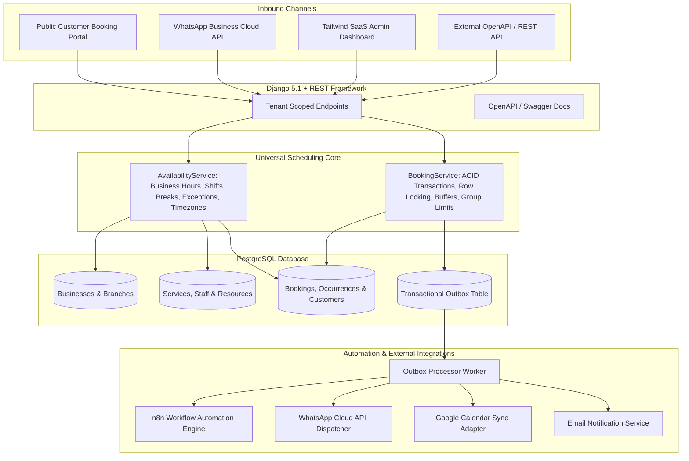

# Universal Appointment Booking Engine

**Project 12 of 100 Days of AI Challenge &bull; Days 56 through 60**

A production-oriented, API-first, multi-tenant appointment scheduling platform built with **Python 3.12**, **Django 5.1**, **Django REST Framework**, **PostgreSQL 16**, **Tailwind CSS**, and **n8n Automation**.

Instead of building fragmented booking tools for clinics, salons, gyms, and consulting firms, this engine powers all service verticals through a single unified scheduling engine using **declarative booking policies** and **dynamic resource requirements**.

---

## Key Highlights

- **Multi-Tenant Architecture**: Complete data isolation per business, branch, staff, customer, and booking.
- **Unified Scheduling Engine**: The identical code path calculates availability and enforces conflict prevention for:
  - 1:1 Medical Clinic appointments (Doctor + Consultation Room exclusivity)
  - Beauty Salon appointments with post-service turnaround buffers (Stylist + Styling Station)
  - Fitness Gym group classes with participant capacities (15-person Yoga Class) and 1:1 Personal Training.
- **ACID Concurrency Protection**: Database transactions with `select_for_update()` row-level locking prevent double-bookings during simultaneous client reservations.
- **Idempotency Guarantees**: Prevents duplicate bookings from double-clicks or repeated network requests via `idempotency_key`.
- **Transactional Outbox Pattern**: Emits events (`booking.confirmed`, `booking.rescheduled`, `booking.cancelled`) atomically with database commits for reliable delivery to n8n workflows and notification queues.
- **Official WhatsApp Cloud API**: Webhook verification challenge handler and message parser sharing the same booking engine as the web portal.
- **Interactive Tailwind Admin Dashboard**: Metric KPI cards, Business Setup Wizard (zero code changes needed to add new verticals), calendar views, and CRUD managers.
- **Public Customer Booking Portal**: Mobile-first, live slot calculation via REST API, accessible controls, and self-service rescheduling/cancellation.
- **Automated Test Suite**: 12 comprehensive automated test cases verifying multi-tenancy, buffers, concurrency, group capacities, and webhooks.

---

## System Architecture



---

## Project Folder Structure

```text
Universal-Appointment-Booking/
├── backend/
│   ├── config/                     # Django core settings, WSGI, ASGI, URLs
│   ├── apps/
│   │   ├── accounts/               # User profiles and authentication
│   │   ├── businesses/             # BusinessType, Business, Branch, Hours, Web Views
│   │   ├── services/               # Bookable services & resource requirements
│   │   ├── resources/              # Staff & physical resources (rooms, stations)
│   │   ├── availability/           # Staff availability, breaks, exceptions, slot engine
│   │   ├── bookings/               # Booking model, ClassOccurrence, BookingService
│   │   ├── customers/              # Customer records scoped per tenant
│   │   ├── notifications/          # Templates, deliveries, transactional outbox
│   │   └── integrations/           # WhatsApp webhook, Google Calendar sync adapter
│   ├── templates/                  # Tailwind CSS templates
│   │   ├── base.html
│   │   ├── landing.html            # Landing page showcasing 3 verticals
│   │   ├── booking/                # Public customer booking & manage portal
│   │   └── admin/                  # Dashboard, Setup Wizard, CRUD views, Integrations
│   ├── tests/                      # Automated test cases
│   └── manage.py
├── automations/
│   └── n8n/                        # Reusable, importable n8n workflow JSON files
│       ├── 01_booking_confirmation_workflow.json
│       ├── 02_appointment_reminder_workflow.json
│       ├── 03_booking_rescheduling_workflow.json
│       ├── 04_booking_cancellation_workflow.json
│       ├── 05_delivery_retry_workflow.json
│       └── 06_daily_summary_workflow.json
├── docs/
│   ├── ARCHITECTURE.md             # Multi-tenancy and scheduling design
│   ├── ERD.md                      # Mermaid entity-relationship diagram
│   ├── CONFIGURING_A_NEW_BUSINESS.md # Zero-code vertical onboarding guide
│   ├── N8N_INTEGRATION_GUIDE.md    # n8n import & workflow specs
│   └── INTEGRATIONS_AND_CALENDAR.md# WhatsApp & Google Calendar documentation
├── scripts/
│   ├── run_local.sh                # Local development launcher
│   ├── run_tests.sh                # Test suite runner
│   └── process_outbox.sh           # Outbox processor trigger
├── docker-compose.yml              # Multi-container setup (Web, Postgres, n8n)
├── Dockerfile                      # Production container image
├── requirements.txt                # Python dependencies
├── .env.example                    # Environment variable template
└── README.md
```

---

## Quickstart & Local Setup

### 1. Prerequisites
- Python 3.12+ (or Docker Compose)
- Git

### 2. Clone and Setup Environment
```bash
git clone https://github.com/your-username/Universal-Appointment-Booking.git
cd Universal-Appointment-Booking

# Create and activate virtual environment
python3 -m venv venv
source venv/bin/activate

# Install dependencies
pip install -r requirements.txt

# Copy environment variables
cp .env.example .env
```

### 3. Run Migrations & Seed Demo Verticals
```bash
# Apply database migrations
python backend/manage.py migrate

# Seed pre-configured Clinic, Salon, and Gym verticals
python backend/manage.py seed_demo_data
```

### 4. Start the Application
```bash
python backend/manage.py runserver 127.0.0.1:8000
```
Open **[http://127.0.0.1:8000](http://127.0.0.1:8000)** in your browser!

---

## Running with Docker Compose

To run PostgreSQL, Django, and n8n together:
```bash
docker compose up -d --build
```
- Web Application & Admin: [http://localhost:8000](http://localhost:8000)
- OpenAPI / Swagger Docs: [http://localhost:8000/api/docs/](http://localhost:8000/api/docs/)
- n8n Workflow Automation: [http://localhost:5678](http://localhost:5678)

---

## Demo Verticals Showcase

All three businesses operate simultaneously through the exact same booking engine:

| Vertical | Business Name | Demo Services | Capacity Rule |
| :--- | :--- | :--- | :--- |
| **Clinic** | Demo Health Clinic | General Consultation (30m), Follow-up (20m) | 1:1 Exclusive: Doctor A/B & Consultation Room 1/2 |
| **Salon** | Demo Beauty Studio | Haircut (45m), Coloring (90m), Styling (30m) | 1:1 with 15m Turnaround Buffers & Styling Stations |
| **Gym** | Demo Fitness Center | Vinyasa Yoga (60m, Cap: 15), Personal Training (45m) | Hybrid: 15-person Group Sessions + 1:1 PT |

### Default Admin Credentials:
- **Username**: `admin`
- **Password**: `admin12345`
- Admin Dashboard URL: `http://localhost:8000/dashboard/`

---

## Interactive API Documentation

Interactive Swagger and OpenAPI specifications are available at:
- **Swagger UI**: [http://localhost:8000/api/docs/](http://localhost:8000/api/docs/)
- **ReDoc**: [http://localhost:8000/api/redoc/](http://localhost:8000/api/redoc/)
- **OpenAPI Schema (JSON/YAML)**: [http://localhost:8000/api/schema/](http://localhost:8000/api/schema/)

### Core API Endpoints:
```http
GET  /api/v1/businesses/                            # List active business tenants
GET  /api/v1/businesses/{slug}/services/            # List services for business
GET  /api/v1/businesses/{slug}/staff/               # List qualified staff
GET  /api/v1/businesses/{slug}/availability/        # Query available slots (service, date)
POST /api/v1/businesses/{slug}/bookings/            # Create booking (supports idempotency)
GET  /api/v1/businesses/{slug}/bookings/{id}/       # Retrieve booking details
POST /api/v1/businesses/{slug}/bookings/{id}/cancel/ # Cancel booking
POST /api/v1/businesses/{slug}/bookings/{id}/reschedule/ # Reschedule booking
POST /api/v1/integrations/whatsapp/webhook/         # WhatsApp Cloud API Webhook
```

---

## Automated Test Results

The test suite covers multi-tenancy, booking concurrency, group capacity, cancellation policies, idempotency, and webhook verification:

```bash
python backend/manage.py test backend/tests -v 2
```

```text
Found 12 test(s).
Creating test database for alias 'default'...
System check identified no issues (0 silenced).
test_availability_api (test_api_endpoints.BookingAPITestCase) ... ok
test_create_booking_api (test_api_endpoints.BookingAPITestCase) ... ok
test_tenant_isolation (test_api_endpoints.BookingAPITestCase) ... ok
test_whatsapp_webhook_verification (test_api_endpoints.BookingAPITestCase) ... ok
test_calendar_sync_service (test_automations_and_integrations.AutomationsAndIntegrationsTestCase) ... ok
test_notification_template_rendering (test_automations_and_integrations.AutomationsAndIntegrationsTestCase) ... ok
test_outbox_event_emitted_and_processed (test_automations_and_integrations.AutomationsAndIntegrationsTestCase) ... ok
test_cancellation_policy_enforcement (test_scheduling_engine.UniversalSchedulingEngineTestCase) ... ok
test_clinic_booking_and_double_booking_prevention (test_scheduling_engine.UniversalSchedulingEngineTestCase) ... ok
test_gym_group_class_capacity_limit (test_scheduling_engine.UniversalSchedulingEngineTestCase) ... ok
test_idempotent_booking_requests (test_scheduling_engine.UniversalSchedulingEngineTestCase) ... ok
test_salon_buffer_time_and_resource_exclusivity (test_scheduling_engine.UniversalSchedulingEngineTestCase) ... ok
----------------------------------------------------------------------
Ran 12 tests in 0.282s

OK
```

---

## Testing Demonstrations

### 1. Test Clinic Double-Booking Prevention:
1. Open [http://localhost:8000/book/demo-health-clinic/](http://localhost:8000/book/demo-health-clinic/).
2. Book **General Consultation** with **Doctor A** for tomorrow at **10:00 AM**.
3. Attempt to book another patient with **Doctor A** at **10:00 AM** &rarr; Notice 10:00 AM is no longer offered for Doctor A (or rejected with 409 Conflict if submitted concurrently).

### 2. Test Salon Post-Service Buffer:
1. Open [http://localhost:8000/book/demo-beauty-studio/](http://localhost:8000/book/demo-beauty-studio/).
2. Book **Designer Haircut** (45m + 15m buffer) at **10:00 AM**.
3. The stylist and styling station remain blocked until **11:00 AM**.

### 3. Test Gym Group Class Participant Capacity:
1. Open [http://localhost:8000/book/demo-fitness-center/](http://localhost:8000/book/demo-fitness-center/).
2. Select **Vinyasa Yoga Flow** &rarr; Select tomorrow's **10:00 AM** session.
3. Multiple clients can book into the same class occurrence; the engine displays remaining spots (`14 spots left`, `13 spots left`, etc.) and automatically closes when capacity (15) is reached.

### 4. Zero-Code Business Vertical Onboarding:
1. Navigate to [http://localhost:8000/dashboard/demo-health-clinic/setup/](http://localhost:8000/dashboard/demo-health-clinic/setup/).
2. Enter a new vertical name (e.g. `Metropolitan Law Firm` or `Paws & Claws Pet Grooming`).
3. Fill in duration, price, resource requirements, and submit &rarr; The new business immediately becomes bookable and visible in the admin tenant switcher.

---

## Remaining Limitations & Production Notes

1. **Live Meta WhatsApp Credentials**: A simulated mock mode is enabled by default (`WHATSAPP_MOCK_MODE=True`). For real WhatsApp messages, set a valid Meta Graph API bearer token and Phone Number ID in `.env`.
2. **Google Calendar OAuth**: Live Google Calendar sync requires `GOOGLE_CALENDAR_CLIENT_ID` and consent screen verification from Google Cloud Console. The documented `MockCalendarAdapter` is active by default.
3. **Medical Data Notice**: Synthetic demo patient data is used in all clinic examples. Medical compliance assessments (e.g., HIPAA) must be conducted before using in production clinical healthcare environments.

---

**Project Number: 12**  
**Challenge Days: 56–60**  
**Project Name: Universal Appointment Booking Engine**
