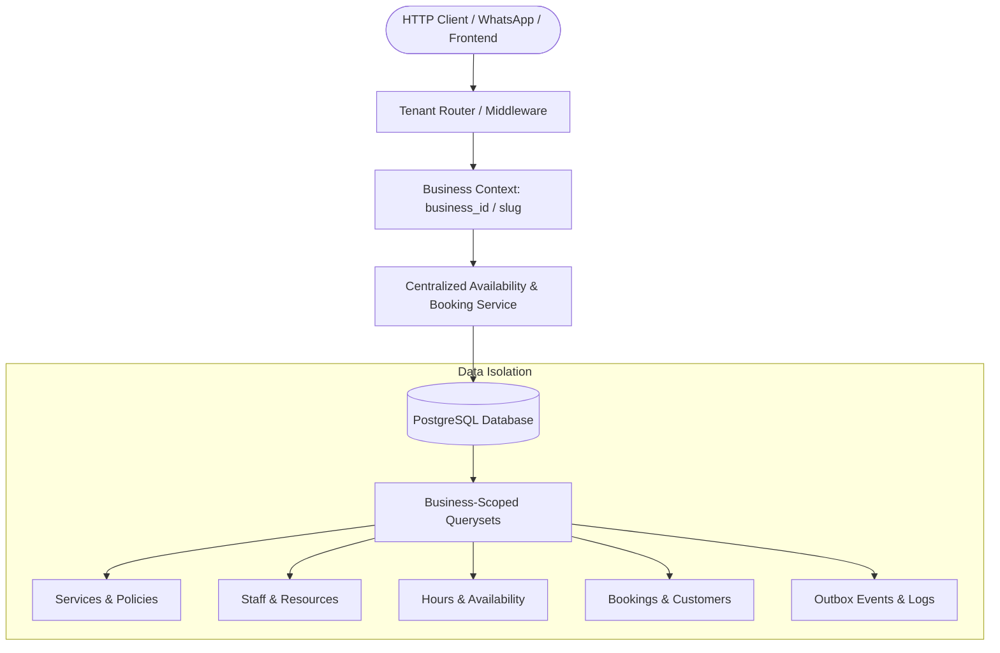
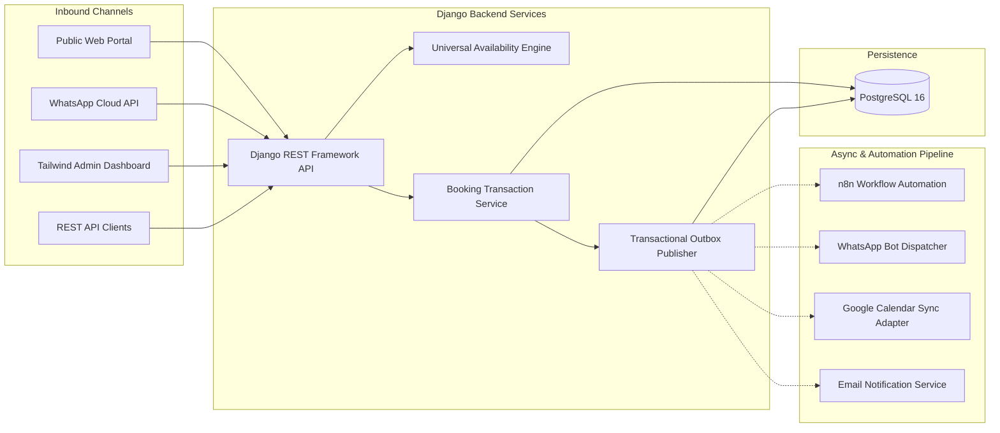

# System Architecture & Multi-Tenant Model

## Overview

The **Universal Appointment Booking Engine** is an API-first, multi-tenant scheduling platform designed to serve diverse industries (healthcare clinics, beauty salons, fitness centers, and professional service firms) with a single, highly configurable core.

Instead of building siloed, hardcoded booking logic per vertical, the engine uses **declarative service policies** and **reusable resource requirements**.

---

## 1. Multi-Tenant Isolation Model

Tenant isolation is strictly enforced at every layer:

### Isolation Guarantees:
1. **Database Foreign Keys**: Every resource, service, staff, customer, booking, and notification belongs to a `Business` tenant.
2. **Business-Scoped QuerySets**: API endpoints and Admin views require business identification (by slug or membership) and filter all operations: `Booking.objects.filter(business=request.business)`.
3. **Unique Constraints**: Unique constraints (e.g. `(business, email)` for customers, `(business, slug)` for services) are scoped per tenant so businesses cannot view or collide with other tenants' data.
4. **Tenant Security Checks**: Modification actions verify that the logged-in user has `BusinessMember` authorization with valid roles (`owner`, `admin`, `staff`).

---

## 2. Policy-Driven Scheduling Engine

The engine eliminates industry-specific hardcoding through flexible abstractions:

| Dimension | Clinic Example | Salon Example | Gym Example |
| :--- | :--- | :--- | :--- |
| **Service** | General Consultation | Balayage & Cut | Vinyasa Yoga |
| **Duration & Buffer** | 30m + 10m buffer | 90m + 15m buffer | 60m + 15m buffer |
| **Capacity** | 1 (Exclusive 1:1) | 1 (Exclusive 1:1) | 15 (Group session) |
| **Required Staff** | Qualified Doctor | Qualified Stylist | Yoga Instructor |
| **Required Resource** | 1x Consultation Room | 1x Styling Station | 1x Studio Room |
| **Booking Model** | Slot-based 1:1 | Slot-based 1:1 | Scheduled Class Occurrence |

---

## 3. High-Level System Architecture

---

## 4. Time Zone and Daylight Saving Time (DST) Handling

- All timestamps (`start_time`, `end_time`, `created_at`, exceptions) are stored in **UTC** in the database.
- Operating hours and staff schedules are defined in **local business time** according to the business's IANA time zone (e.g. `America/New_York`, `Europe/London`, `Asia/Karachi`).
- When generating available slots, the engine converts local business day boundaries to UTC using Python's `zoneinfo`, properly handling transitions across DST boundaries.
