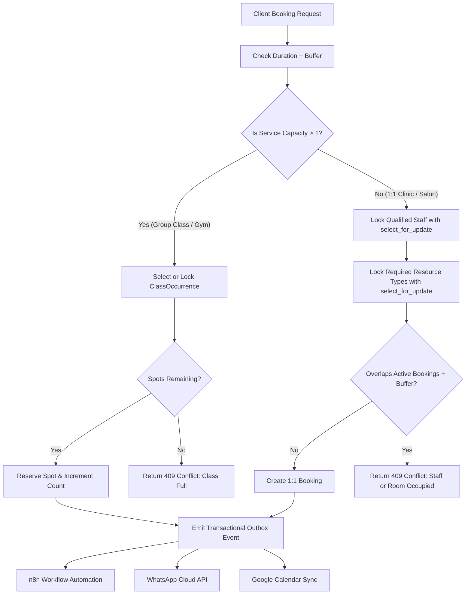

# Configuring a New Business Type (Zero-Code Guide)

The Universal Appointment Booking Engine is built on declarative policies and dynamic resource bindings. You do **not** need to write Python code, create custom models, or alter database schemas to support a brand new vertical (such as a Law Practice, Auto Repair Shop, Pet Groomer, or Massage Therapy).

---

## Method 1: Using the Interactive Admin Setup Wizard

1. Open your browser and navigate to:
   ```
   http://localhost:8000/dashboard/demo-health-clinic/setup/
   ```
   *(Or click **Setup Wizard** in the admin sidebar).*

2. **Step 1: Select Business Type**
   - Choose an existing type (`Clinic`, `Salon`, `Gym`), or select `Custom`.

3. **Step 2: Enter Business Profile & Timezone**
   - Business Name (e.g. `Prestige Law Chambers`)
   - Contact Email & Phone
   - IANA Timezone (e.g. `Europe/London`, `America/New_York`, `Asia/Karachi`)

4. **Step 3: Define Primary Service & Policies**
   - Service Name (e.g. `Initial Legal Consultation`)
   - Duration (e.g. `60 minutes`)
   - Turnaround Buffer (e.g. `15 minutes`)
   - Capacity (`1` for exclusive 1:1, or `>1` for group webinars/classes)
   - Price (e.g. `$250.00`)

5. **Step 4: Configure Practitioners & Resources**
   - Practitioner Name (e.g. `Attorney Robert Vance`)
   - Dedicated Resource / Room (e.g. `Conference Room A` with type `Conference Room`)

6. **Submit**:
   - The engine automatically provisions operating hours, staff schedules, and calendar connections.
   - Your customer booking link is instantly live at:
     ```
     http://localhost:8000/book/prestige-law-chambers/
     ```

---

## Method 2: Using the REST API

You can configure new verticals programmatically via the versioned API:

### 1. Create a Business
```http
POST /api/v1/businesses/
Content-Type: application/json

{
  "name": "Apex Auto Care",
  "business_type": 2,
  "time_zone": "America/Chicago",
  "contact_email": "service@apexauto.local",
  "settings": {
    "min_notice_hours": 2,
    "max_advance_days": 30,
    "slot_interval_minutes": 30,
    "cancellation_deadline_hours": 12,
    "confirmation_mode": "auto"
  }
}
```

### 2. Add a Service with Resource Binding
```http
POST /api/v1/businesses/apex-auto-care/services/
Content-Type: application/json

{
  "name": "Brake Inspection & Replacement",
  "duration_minutes": 60,
  "buffer_time_minutes": 15,
  "capacity": 1,
  "price": "180.00",
  "booking_policies": {
    "requires_staff": true,
    "requires_resource": true,
    "resource_type": "Service Bay"
  }
}
```

### 3. Add Resources
```http
POST /api/v1/businesses/apex-auto-care/resources/
Content-Type: application/json

{
  "name": "Hydraulic Bay 1",
  "resource_type": "Service Bay",
  "capacity": 1
}
```

---

## How the Unified Engine Executes Differing Verticals


